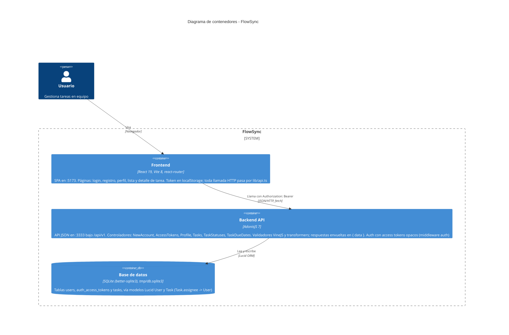

# Arquitectura de FlowSync

Diagrama de contenedores (nivel 2 de C4) de FlowSync: la SPA de React que usa la persona, la API AdonisJS que atiende `/api/v1` y la base de datos SQLite a la que accede mediante Lucid. Dentro de cada contenedor se muestran los bloques que existen hoy en el código. Solo se dibuja lo verificable en el repositorio.

